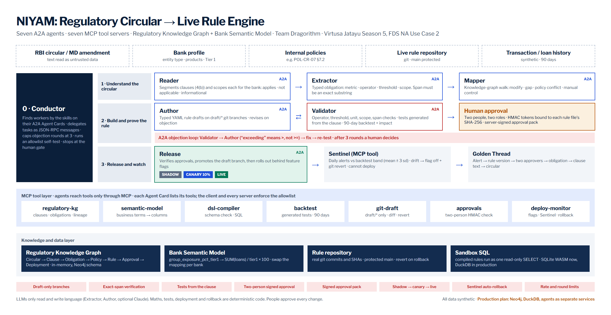

# NIYAM

**Every clause becomes a rule.** NIYAM turns a regulatory circular into a tested, two-person-approved, live bank rule, and traces every alert back to the sentence that caused it.

Team Dragorithm · Sri Manakula Vinayagar Engineering College, Puducherry · Virtusa Jatayu Season 5, FDS NA Use Case 2: *Regulatory Circular to Live Rule Engine*.

**Live:** https://niyam-ivory.vercel.app · **Submission pack:** [`submission/`](submission/) (deck, deck as PDF, explainer video, architecture, research write-up `niyam.html`)



> Everything the demo shows is **synthetic**: the circular `RBI-SYN-2026-017`, the bank, its loans, rules, approvers and alerts. RBI statistics quoted on the site are public and cited at their source.

## Run it

```bash
npm install
npm run demo        # whole pipeline in the terminal, ends with the Golden Thread
npm test            # 21 tests, including the 14 rule tests generated for the demo rule set
npm run dev         # site at http://localhost:3000, console at /console
```

Options for the demo: `--no-drift` (clean rollout), `--llm` (needs `ANTHROPIC_API_KEY`), `--verbose` (print every A2A message).

No keys, databases or Docker are needed. Copy `.env.example` to `.env.local` to set the optional ones.

## What happens in a run

1. **Conductor** discovers six workers by the skill tags on their A2A Agent Cards, then runs an allowlist self-test: the Extractor asks for the deploy API and is refused by its own MCP client and again by the server.
2. **Reader** splits the circular at its own numbering (`4(b)`) and scopes each clause for a UCB: 4 apply, 1 is for Upper Layer NBFCs only, 4 are informational.
3. **Extractor** turns applicable clauses into typed obligations. Each carries a span that must be an exact substring of its clause, or it is rejected.
4. **Mapper** walks the knowledge graph: 2 live rules to modify, 1 gap (new rule), 1 policy conflict (internal policy §7.2 lets the Board approve 15%; the circular sets 12% and forbids overrides), 1 manual control.
5. **Author** drafts on `draft/RBI-SYN-2026-017`. For SYN-EXP-012 it makes a minimal diff of the live rule and so carries over `>=` and the Board exception.
6. **Validator** objects over A2A: clause 4(b) says *exceeding*, so the rule must fire on `>`, and para 5 forbids the exception. The boundary test at exactly 12.00% fails. The Author fixes the draft; **14 of 14** generated tests pass.
7. **Validator** backtests 90 synthetic days, old rules against new: 115 to 601 alerts, newly flagged groups, analyst hours, Board items.
8. **Humans**: two named approvers in two roles sign HMAC tokens bound to the SHA-256 of each rule file. Edit one byte and the release is refused.
9. **Release** promotes the draft branch, then shadow (3 days) → canary 10% (4 days) → live. On rollout day 10 an injected fault loads the loan feed twice; the **Sentinel** sees alerts outside the backtest band and rolls back SYN-EXP-011 and SYN-EXP-012 (flag off, git revert). The concentration rule is a ratio, unaffected, and stays live.
10. **Golden Thread**: any alert → rule version and commit → both approvals → obligation → clause text → circular.

## Architecture

| Layer | In this repository |
| --- | --- |
| Agents | Conductor + Reader, Extractor, Mapper, Author, Validator, Release. Each has an A2A v1.0 Agent Card at `/a2a/{agent}/.well-known/agent-card.json` and a JSON-RPC endpoint at `/a2a/{agent}` (`SendMessage`, `GetTask`, `CancelTask`; v0.3 names accepted). In-run calls serialise real JSON-RPC envelopes through a loopback transport. `src/niyam/a2a/` |
| Tools | Seven MCP servers on the official TypeScript SDK: regulatory-kg, semantic-model, dsl-compiler, backtest, git-draft, approvals, deploy-monitor. Allowlists enforced in the client and again in every server. `src/niyam/mcp/` |
| Knowledge graph | Property graph with the Neo4j schema (Circular → Clause → Obligation → Policy → Rule → RuleVersion → Approval → Deployment → Alert). `src/niyam/graph/` |
| Rules | Typed YAML DSL (zod schema, strict), compiled to analytical SQL that runs on DuckDB or SQLite. Percentages are `ROUND(num * 100.0 / den, 6)` so a value on the limit compares as equal. `src/niyam/dsl/` |
| Tests | Generated from the obligation, never from the draft: below, on and above the limit, out-of-scope entity, plus clause-specific cases. `src/niyam/dsl/testgen.ts` |
| Rule repository | Real git (isomorphic-git) on an in-memory file system; agents may only commit to `draft/*`. `src/niyam/git/` |
| Sandbox | SQLite compiled to WebAssembly (sql.js) over a seeded 90-day synthetic loan book. `src/niyam/sql/`, `src/niyam/data/` |
| Approvals | HMAC-SHA256 tokens over rule id, version, file hash, approver and role. Two people, two roles. `src/niyam/approvals/` |
| LLM | Optional. With `ANTHROPIC_API_KEY`, the Extractor and Author call Claude (`claude-opus-5-5`) with structured outputs; every answer is still span-checked, schema-checked and tested. Errors fall back to the rule-based path, which the run log records. `src/niyam/llm/` |
| Site | Next.js App Router: landing page, live console (server-sent events), architecture, research. `src/app/`, `src/components/` |

### What is simulated

Agents run in one deployment rather than separate services; the knowledge graph, git repository and SQL engine are in memory per request; the data is synthetic. The interfaces (A2A cards and messages, MCP tools, compiled SQL, Cypher) are the ones a bank deployment would use.

## Try an agent directly

```bash
curl -s http://localhost:3000/a2a/validator/.well-known/agent-card.json

curl -s http://localhost:3000/a2a/extractor -H 'content-type: application/json' -d '{
  "jsonrpc":"2.0","id":"1","method":"SendMessage","params":{"message":{
  "messageId":"m1","role":"ROLE_USER","parts":[{"data":{"skill":"extract-obligations",
  "input":{"clause":{"number":"4(b)","text":"A regulated entity shall flag for report any group of connected counterparties with an aggregate exposure exceeding 12 per cent of Tier 1 capital."}}}}]}}}'
```

## Picture credits

- "Mumbai, reserve bank of india 01" and "02" by Sailko, CC BY 3.0, via Wikimedia Commons
- "Tower and building of Reserve Bank of India, Mumbai 03" and "Street photography in Pondicherry 07" by Pinakpani, CC BY-SA 4.0, via Wikimedia Commons
- "Coins of the Indian rupee" by ChiK, CC BY-SA 4.0, via Wikimedia Commons
- "Pittsboro Merchant Business Ledger", public domain, via Wikimedia Commons

## Team

Senaaravichandran A, Abiyshek S, Jerrick Austin Manuel G, Venkat Narayanan S, Vishal R. Mentor: Prof. Suresh R.
